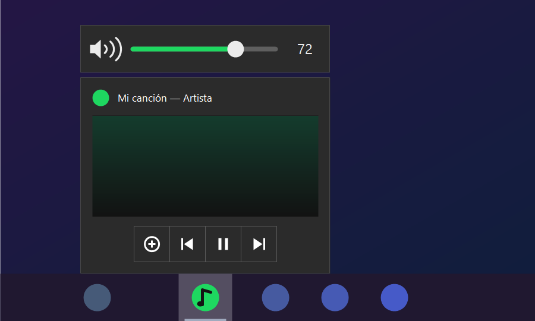
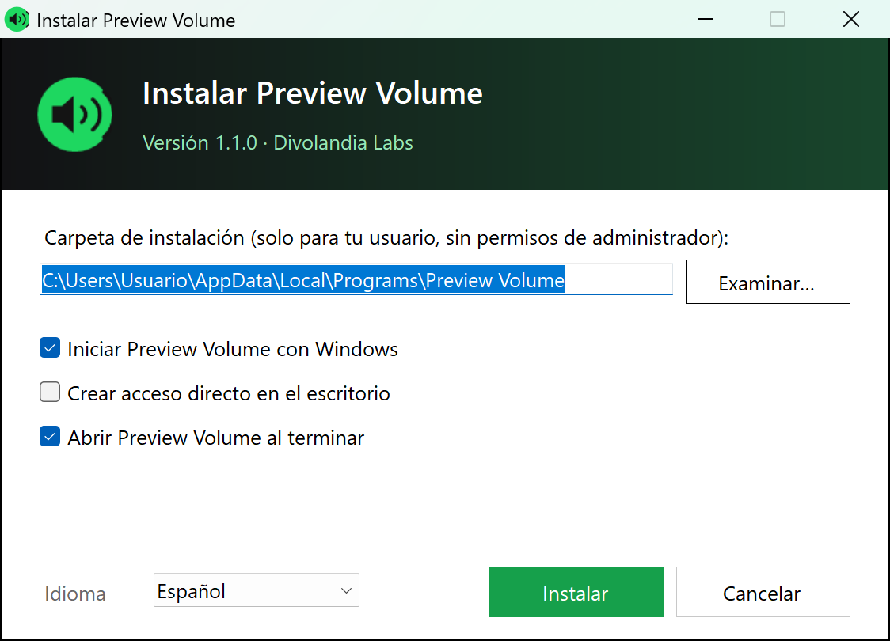

# Preview Volume

> Uma barra de volume acima da pré-visualização do Spotify na barra de tarefas do Windows.

[Español](README.md) · [English](README.en.md) · **Português** · [Français](README.fr.md) · [Deutsch](README.de.md) · [Italiano](README.it.md) · [Polski](README.pl.md) · [Русский](README.ru.md) · [한국어](README.ko.md) · [日本語](README.ja.md)

**Web:** https://divolandialabs.github.io/preview-volume/ · **Download:** [PreviewVolume-Setup.exe (versão mais recente)](https://github.com/DivolandiaLabs/preview-volume/releases/latest)



## Descrição

Quando você passa o mouse sobre o ícone do Spotify na barra de tarefas, o Windows mostra uma pré-visualização com os botões anterior, pausar e próxima — mas não dá para mudar o volume. O Preview Volume coloca logo acima dessa pré-visualização uma pequena barra com um controle deslizante, a porcentagem e um botão de mudo.

O Windows só deixa o próprio aplicativo colocar botões na sua pré-visualização, e o Spotify já usa os dele. Por isso o Preview Volume desenha a sua própria janelinha colada à pré-visualização e altera o volume do Spotify no **mixer de volume do Windows**, e não o controle interno do Spotify (os dois se somam).

É um programa minúsculo (cerca de 40 KB) que fica ao lado do relógio, não se conecta à internet e quase não consome recursos.

## Recursos

- **Controle deslizante de volume** acima da pré-visualização, com a mesma largura.
- **Roda do mouse** sobre a pré-visualização ou a barra: aumenta ou diminui o volume de 2 em 2 %.
- **Clique no alto-falante** para silenciar ou reativar o som.
- Some sozinha quando você afasta o mouse e não desaparece enquanto você vai da pré-visualização até a barra.
- Opção **«Mostrar em todos os apps com som»**: Chrome, Brave, players… (por padrão, só o Spotify).
- Ícone na bandeja do sistema com **iniciar com o Windows** opcional.
- Funciona com vários monitores e qualquer escala de tela (100 %, 150 %, 200 %…).
- **Barra clássica ou do Windows 11**: com a barra estilo Windows 10 (ou Windows 11 com o ExplorerPatcher) a barra fica colada à pré-visualização; com a nova barra do Windows 11 ela é posicionada acima, a partir do botão da barra de tarefas. Escolha na instalação ou no menu do ícone.


## Instalação

1. Baixe **`PreviewVolume-Setup.exe`** na [página de versões](https://github.com/DivolandiaLabs/preview-volume/releases/latest).
2. Abra e clique em **Instalar**. O instalador abre no idioma do Windows e pode ser trocado no canto inferior esquerdo (10 idiomas). A instalação é só para o seu usuário, em `%LOCALAPPDATA%\Programs\Preview Volume`, sem pedir permissão de administrador.
3. Escolha se ele deve iniciar com o Windows, se você quer um atalho na área de trabalho e qual **barra de tarefas** usa: Windows 10 (ou ExplorerPatcher) ou Windows 11. O instalador sugere a que detecta.



O programa não é assinado digitalmente, então na primeira vez o Windows SmartScreen pode avisar: clique em **Mais informações → Executar assim mesmo**.

Para desinstalar: **Configurações → Aplicativos → Aplicativos instalados → Preview Volume → Desinstalar**.

Instalação silenciosa: `PreviewVolume-Setup.exe /silencioso` (opções: `/dir "pasta"`, `/escritorio`, `/sininicio`, `/abrir`, `/idioma pt`, `/barra10`, `/barra11`).

## Uso

- Toque música no Spotify e passe o mouse sobre o ícone dele na barra de tarefas: a barra de volume aparece acima da pré-visualização.
- Arraste o controle, use a roda do mouse ou clique no alto-falante para silenciar.
- Clique com o botão direito no ícone verde ao lado do relógio para abrir o menu: todos os apps com som, iniciar com o Windows e sair.
- Para fechar pela linha de comando: `PreviewVolume.exe /salir`.

## Requisitos

- Windows 10 ou 11 com .NET Framework 4.8 (já vem com o Windows).
- Funciona com a barra clássica (Windows 10, ou Windows 11 com o ExplorerPatcher) e com a nova barra do Windows 11. Na nova, o Windows não permite ler a pré-visualização, então a posição da barra é aproximada; na clássica fica colada exatamente.
- O instalador está em 10 idiomas; a barra e o menu do programa estão em espanhol.

## Compilar a partir do código

Não é preciso instalar nada: compila com o compilador de C# que já vem no Windows.

```powershell
powershell -ExecutionPolicy Bypass -File build.ps1
```

Gera `bin\PreviewVolume.exe` e o instalador `bin\PreviewVolume-Setup.exe`. O ícone é desenhado pelo próprio programa.

## Privacidade

O Preview Volume não se conecta à internet nem coleta dados. A sua única configuração fica em `config.ini`, junto ao programa.

## Licença

© 2026 Divolandia Labs. Todos os direitos reservados. O programa é gratuito; o código é publicado para consulta.

---
*Desenvolvido por [DivolandiaLabs](https://divolandialabs.github.io/)*
